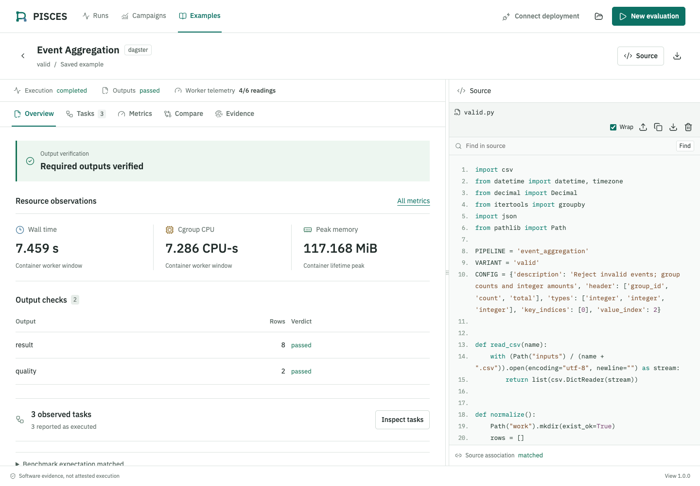
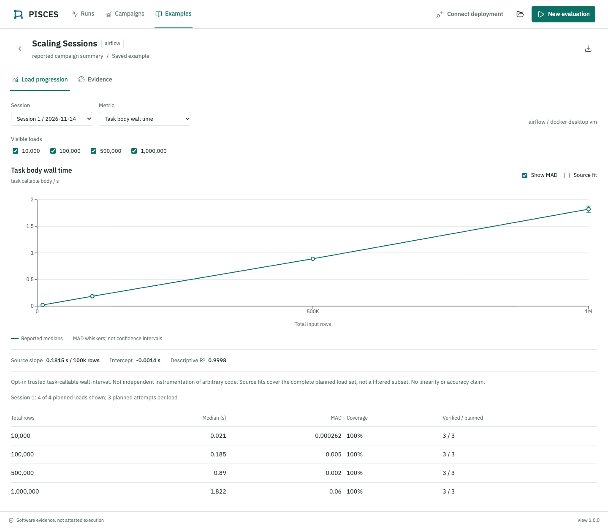
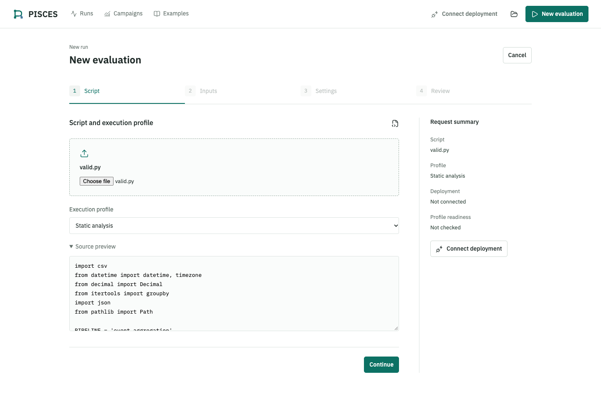

<p align="center">
  
</p>

# Pipeline Intelligent Sustainability & Carbon Evaluation Suite

**PISCES evaluates pipeline code and makes the evidence behind its results inspectable.**
Use the browser workspace or the Python CLI to inspect static design findings,
run bounded diagnostics, execute approved workloads in isolated Linux containers,
and export comprehensive JSON reports. Airflow, Prefect and Dagster have separate
native execution profiles; the browser and CLI share the Python evaluation core.

**Status: research/developer preview.** The bounded execution and reporting paths
are usable today. PISCES is not a calibrated power meter, a general proof of
pipeline equivalence, or a public service for running hostile code. Missing data
and ineligible comparisons are reported explicitly, not converted to zeroes.

[Get Started](#get-started) · [CLI Guide](docs/CLI_REFERENCE.md) ·
[HTTP API](docs/API.md) · [Deployment](docs/EXECUTION_SERVICE.md) ·
[Documentation Index](docs/README.md)

## The Workspace



The workspace separates deployment runs from saved examples. Reports open on an
overview with output verdicts, measurement scopes and comparison eligibility.
Optional source inspection, task states, metric definitions and provenance are
available without crowding the overview.



Campaigns plot actual numeric load sizes, show coverage and median/MAD, and keep
independent sessions separate. A larger dataset is **not assumed** to produce a
linear increase: fixed startup costs, caching, scheduling and memory high-water
behavior can all affect the observations. Source fits are displayed only where
the supplied campaign evidence permits them.



Upload a script, supply native contract inputs where applicable, choose a ready
profile, and review the request before authorizing execution. Screenshots use
sanitized, committed examples; they are not new benchmark results.

## Get Started

### Browser: Docker Compose

Requires Docker Engine/Desktop running Linux containers, cgroup v2, the default
seccomp profile, a local Docker Unix socket, and Compose **2.24.4+**. Python 3 is
used once to prepare the local deployment secret. No host Node.js install is
needed for this route.

```bash
git clone https://github.com/aliduabubakari/PISCES.git
cd PISCES
python3 scripts/prepare_compose.py
docker compose -f compose.yaml -f compose.prod.yaml up --build -d
```

Open **[http://127.0.0.1:8080/](http://127.0.0.1:8080/)**. Open **Deployment
connection**, enter the token from `.secrets/api-token`, and select **Connect
API**. The token is local and must not be committed or included in screenshots.
Select **New evaluation**, or browse **Examples** without connecting.

Only `static` and self-contained `python` execution are enabled by default.
Airflow/Prefect/Dagster need separately approved engine images and contract-bound
inputs. See [native profile setup](docs/EXECUTION_SERVICE.md#enable-native-engines).

This deployment is for a **single trusted operator**. The API has no Docker
socket; the worker does. Do not expose it to untrusted users. Remote deployments
need TLS, an operator access boundary and explicit host/origin configuration.
Uploaded source, fixtures and reports are retained in the deployment's SQLite
volume until their terminal job is deleted. `docker compose down` retains data;
`down --volumes` destroys it. Deletion is not secure erasure of disk/backups.

### CLI: Install From This Checkout

Python **3.10+** is declared; **3.12** is the tested container runtime. Install
from source so the CLI, schemas, examples and documentation stay together. These
instructions do not assume that a matching release exists on PyPI.

```bash
python3.12 -m venv .venv
source .venv/bin/activate
python -m pip install -e '.[web,dev,yaml]'

# Static analysis: does not execute the uploaded workflow.
pisces evaluate test_scripts/airflow/simple_etl.py --out-file reports/static.json

# Environment readiness; skip the optional CodeCarbon smoke check here.
pisces diagnostics test_scripts/airflow/simple_etl.py --skip-codecarbon-smoke

# Export a portable, schema-validated view for the browser.
pisces report-view reports/static.json --out reports/static.view.json
```

`evaluate` creates the output parent directory. View exports refuse to overwrite
an existing file. Open the view JSON in the browser with **Open report**. Raw
canonical reports can also be admitted through a connected report API.

For bounded no-data diagnostics, **not native workflow execution**:

```bash
pisces evaluate test_scripts/airflow/simple_etl.py \
  --enable-energy-eval --energy-mode fuzz_fill --energy-seed 1729 \
  --out-file reports/surrogate.json
```

CodeCarbon estimates, LLM-assisted recipes and dotenv loading are opt-in extras:
`.[energy]`, `.[llm]`, `.[dotenv]`. No LLM API key is needed for static evaluation,
deterministic fuzz-fill, the default execution service or saved examples.
See [CLI modes, native execution, exit codes and all flags](docs/CLI_REFERENCE.md).

### HTTP API: Another Client Of The Same Backend

The frontend is optional. Submit a script to `POST /api/v1/jobs`, poll the job,
then retrieve its comprehensive JSON from `GET /api/v1/jobs/{id}/report`.
Use `GET /api/v1/jobs/profiles` before submitting; enabled images are an operator
decision, not a client-provided Docker command.

For report viewing only, with no execution worker:

```bash
pisces serve-api --port 8000
```

This command binds loopback. Execution requires the authenticated API/worker
deployment above. See the [HTTP API guide](docs/API.md) for authentication,
copyable Python requests, native input bundles, errors, limits and retention.
The [generated OpenAPI snapshot](docs/reference/openapi.json) is committed;
authenticated `/openapi.json` describes a running deployment.

## What The Results Mean

| Evidence | Available now | Important boundary |
| --- | --- | --- |
| Static design findings | AST/manifest rules, locations and explanations | A possible design issue is not measured energy use |
| No-data diagnostics | Deterministic surrogate/sample-data modes | Do not execute the original workflow or establish its correctness |
| Operational telemetry | Scoped wall time, process CPU/RSS and Linux cgroup counters | Software observations; Docker Desktop counters belong to its Linux VM |
| Native engine evidence | Airflow, Prefect and Dagster task/step states in qualified bounded profiles | Not a production scheduler/executor-parity guarantee |
| Output verification | Contract-bound assertions and equivalence against supplied reference artifacts | Only as strong as the contract, oracle and covered inputs |
| Energy/carbon | Optional CodeCarbon software estimates with assumptions and missingness | Secondary modeled evidence, not electrical measurement |
| Comparisons | Output/telemetry gates and controlled campaign summaries | Standalone jobs are not eligible resource rankings |
| Task inspection | Task states and explicit missing readings | General per-task CPU/time/memory collection is **not yet implemented** |

Execution success, output correctness, measurement availability and comparison
eligibility are separate verdicts. PISCES does not divide whole-pipeline metrics
among tasks, treat missing readings as zero, or infer annual workflow emissions
from a surrogate run. Scaling results establish observed behavior under their
recorded environment, not calibrated accuracy or universal linearity.

Canonical unified reports currently use schema **1.4.0**; report/campaign view
contracts use **1.0.0**. The CLI/API return canonical reports; views are derived
presentation artifacts. Hashes bind source and inputs, but reports are not signed
or remotely attested. [Schemas](src/pisces/schemas) and
[measurement protocol](docs/CONTROLLED_EXPERIMENT_PROTOCOL.md) define the boundaries.

## Benchmark And Demo Set

Five deterministic pipeline families test more than one workload shape:

| Pipeline | Workload |
| --- | --- |
| Climate Fusion | Normalize temperature observations from five sources |
| Event Aggregation | Group event records by key |
| Order Enrichment | Join orders with lookup data |
| Sensor Windows | Aggregate sensor readings into windows |
| Inventory Latest | Select the latest inventory state |

Every family includes `valid`, `equivalent`, `same_shape_wrong` and `partial`
cases. The latter two should be rejected by output checks even when execution
succeeds. A standalone suite checks the generated Python workload/oracle; it
does **not** qualify an orchestrator.

```bash
pisces-benchmarks list
pisces-benchmarks build benchmark-runs/demo --rows 10000 --keys 32 --target airflow
pisces-benchmarks run benchmark-runs/demo benchmark-runs/results --backend standalone
```

Use fresh build/result directories. See [the benchmark suite](docs/BENCHMARK_SUITE.md)
for OCI execution, and [engine qualification](docs/ENGINE_QUALIFICATION.md) for
native failure tests. [Climate Fusion](benchmarks/climate_fusion/README.md) also
provides controlled 10k/100k/500k/1M-row sweeps and independent session checks.
The [small release demo](demo/README.md) covers sample mapping, report export and
intentional comparison/projection refusals without private datasets.

## Architecture And Development

```text
CLI ---------------------------> Python evaluator -> canonical JSON
Browser -> frontend -> HTTP API -> SQLite queue -> trusted worker
                                                    |
                                       disposable evaluation container
                                                    |
                                    canonical JSON -> report/campaign views
```

The evaluator owns report semantics and admission; React/TypeScript renders
Python-owned view schemas. API and worker are separate processes/images. The
frontend has no evaluator logic and accepts neither arbitrary Docker flags nor
server filesystem paths. See [service architecture](docs/EXECUTION_SERVICE.md),
[workspace development](docs/FRONTEND_WORKSPACE.md) and the
[documentation index](docs/README.md).

```bash
# Python unit/contract tests; native integration tests are opt-in.
python -m pytest -q
python scripts/export_reference_docs.py --check

# Frontend: Node 22.12+; use the version in frontend/.nvmrc.
cd frontend
npm ci
npm test
npm run build
npm run test:e2e
```

Live execution browser tests need a disposable Compose stack and the explicit
test credentials described in [the testing guide](docs/EXECUTION_SERVICE.md#development-and-tests).
Never use its deliberately public token for production.

Generated run reports, diagnostics, databases, caches, secrets and build outputs
are ignored by Git. Curated examples, golden reports, schemas, source fixtures,
the [editable logo and screenshots](assets/README.md) remain versioned. Do not
add private datasets or credentials to a report fixture.

## License

[MIT](LICENSE). This is a research tool: validate its assumptions against your
workload and environment before using its results to support an optimization or
carbon claim.
